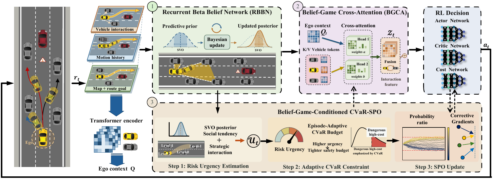
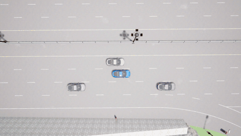
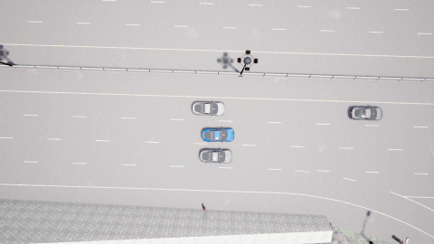
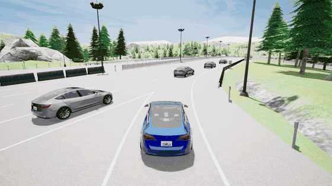

# Risk-Constrained Autonomous Driving Decisions Under Social Interaction Uncertainty

**SPO–SVO–CVaR** is a reinforcement learning framework for autonomous driving in CARLA. When the ego vehicle needs to change lanes or merge, the policy uses observed interactions to anticipate how neighboring drivers may respond. Those predictions inform both which vehicles the policy attends to and how it balances progress against the risk of a costly maneuver.

[Method](#method) · [Demonstration videos](#demonstration-videos) · [Source files](#source-files)

  

## Method

- **Recurrent Beta Belief Network (RBBN).** Updates a probabilistic estimate of each neighbor’s social value orientation (SVO) as new evidence arrives and predicts the neighbor’s response trajectory.
- **Belief-Game Cross-Attention (BGCA).** Combines the inferred preferences and predicted trajectories with the ego vehicle’s maneuver context. The attention layer uses posterior uncertainty to weight each neighbor’s contribution.
- **Interaction-conditioned CVaR–SPO.** Assigns a tighter episode safety budget when the interaction is more urgent. Conditional value-at-risk (CVaR) emphasizes high-cost episodes in the Simple Policy Optimization (SPO) update.

## Demonstration Videos

### Mandatory Lane Change

**Low SVO.** With a low-SVO neighbor, the ego vehicle yields and changes lanes behind it. [MP4](video/lane-change/low-svo.mp4)

**High SVO.** With a high-SVO neighbor, the ego vehicle takes the opening and changes lanes ahead. [MP4](video/lane-change/high-svo.mp4)

### Ramp Merge

**Low SVO.** With a low-SVO neighbor, the ego vehicle slows and merges behind it. [MP4](video/ramp/low-svo.mp4)

**High SVO.** With a high-SVO neighbor, the ego vehicle merges ahead as the neighbor yields. [MP4](video/ramp/high-svo.mp4)

## Source Files

| Component | Source |
| --- | --- |
| Recurrent Beta belief and posterior update | [`svo_belief.py`](src/models/svo_belief.py) |
| Interaction encoder and response prediction | [`svo_model.py`](src/models/svo_model.py) |
| Observation encoder and BGCA | [`encoder.py`](src/models/encoder.py) |
| Belief- and response-conditioned urgency | [`belief_game_risk.py`](src/algorithms/belief_game_risk.py) |
| Episode budgets and CVaR dual update | [`ppo_model.py`](src/algorithms/ppo_model.py) |
| SPO objective with tail-weighted cost advantage | [`spo_model.py`](src/algorithms/spo_model.py) |
