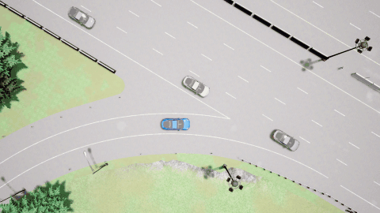

# SPO–SVO–CVaR

Source code accompanying the SPO–SVO–CVaR paper on interactive driving in CARLA. The repository follows the source layout used in the research project.

## Demonstration Videos

### Lane Change

**Low SVO.** The ego vehicle yields to neighboring traffic during the lane-change maneuver. [Watch MP4](video/lane-change/low-svo.mp4).

**High SVO.** The ego vehicle goes first during the lane-change maneuver. [Watch MP4](video/lane-change/high-svo.mp4).

### Ramp Merge

**Low SVO.** The ego vehicle yields to neighboring traffic during the ramp merge. [Watch MP4](video/ramp/low-svo.mp4).

**High SVO.** The ego vehicle goes first during the ramp merge. [Watch MP4](video/ramp/high-svo.mp4).

## Source Files

| Source file | Contents |
| --- | --- |
| [`src/models/svo_belief.py`](src/models/svo_belief.py) | Recurrent Beta belief network and prior/posterior updates |
| [`src/models/svo_model.py`](src/models/svo_model.py) | Interaction encoder, response decoder and SVO inference |
| [`src/models/encoder.py`](src/models/encoder.py) | Hierarchical observation encoder and belief-game cross-attention |
| [`src/algorithms/belief_game_risk.py`](src/algorithms/belief_game_risk.py) | Belief- and response-conditioned interaction urgency |
| [`src/algorithms/ppo_model.py`](src/algorithms/ppo_model.py) | Rollout buffer, episode risk budgets and CVaR dual update |
| [`src/algorithms/spo_model.py`](src/algorithms/spo_model.py) | SPO objective and integration of the CVaR cost advantage |

The uploaded versions of `svo_model.py` and `ppo_model.py` omit sequence pretraining and the base agent's setup and training integration, respectively. End-to-end experiments also require the CARLA environment, experiment configuration, training scripts, data and checkpoints.
