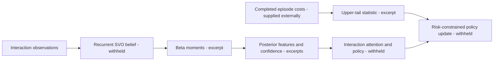

# Module-level overview

The full research code connects observation encoding, recurrent social belief,
interaction representation, and policy optimization. Only the highlighted
statistical operations below are included in this release.

| Symbol / input | Meaning |
| --- | --- |
| alpha, beta in `beta_moments` | Positive Beta shape parameters; unrelated to tail mass |
| `svo_mu`, `svo_sigma` | Per-neighbor posterior mean and standard deviation, in degrees |
| `prior_sigma` | Prior uncertainty scale, supplied by the caller |
| `evidence_strength` | Supplied per-neighbor evidence weight; the excerpt clips it to [0, 1] |
| `values` | Supplied completed-episode cost samples |
| `alpha` in `empirical_upper_tail` | Fraction of samples included in the upper tail |

`posterior_features` returns [cos(mu), sin(mu), sigma/prior_sigma,
log(sigma + 0.001)] per neighbor. `posterior_confidence` multiplies
clipped uncertainty reduction by clipped evidence strength. The learned
projections, response predictor, evidence estimator, and attention fusion
are outside the release.

`empirical_upper_tail` sorts costs in descending order and allocates alpha*n
samples of tail mass. If that count is fractional, the boundary sample gets
fractional weight. The returned tuple contains the tail estimate, per-sample
coefficients, and the empirical boundary cost. No reward, cost, or multiplier
update is included.
